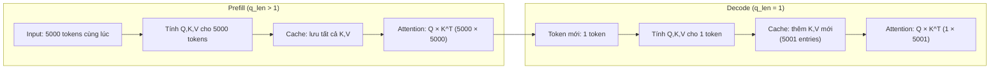
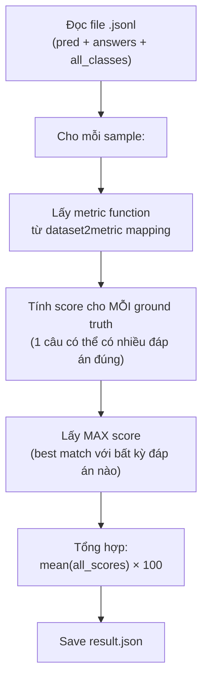

# 🔬 Giải Thích Chuyên Sâu: KV Cache, K-means, Truncation & Metrics

---

## 1. KV Cache — Hiểu Từ Gốc

### 1.1 Attention cơ bản hoạt động thế nào?

Trong mỗi attention layer, công thức cốt lõi:

```
Attention(Q, K, V) = softmax(Q × K^T / √d) × V
```

Trong đó:
- **Q** (Query) = "tôi đang tìm gì?"
- **K** (Key) = "mỗi token có gì để cung cấp?" (giống nhãn/index)
- **V** (Value) = "nội dung thực tế của mỗi token" (giống dữ liệu)
- **d** = head dimension (128 cho LLaMA-2-7B)

```
Ví dụ đơn giản:
Câu: "Con mèo ngồi trên bàn"
                                    
Token:    [Con]  [mèo]  [ngồi]  [trên]  [bàn]
           ↓       ↓       ↓       ↓       ↓
       Q_proj → Q₁    Q₂     Q₃     Q₄     Q₅     (mỗi token hỏi: "tôi nên chú ý đến ai?")
       K_proj → K₁    K₂     K₃     K₄     K₅     (mỗi token đáp: "đây là đặc trưng của tôi")
       V_proj → V₁    V₂     V₃     V₄     V₅     (mỗi token mang: "đây là nội dung của tôi")

Khi tính attention cho token "bàn" (Q₅):
  scores = Q₅ · [K₁, K₂, K₃, K₄, K₅]^T = [0.1, 0.3, 0.2, 0.8, 0.5]
  weights = softmax(scores)               = [0.05, 0.10, 0.07, 0.45, 0.33]
  output  = 0.05·V₁ + 0.10·V₂ + 0.07·V₃ + 0.45·V₄ + 0.33·V₅
  
  → Token "bàn" chú ý nhiều nhất vào "trên" (0.45) — hợp lý vì "trên bàn" liên quan nhau
```

### 1.2 KV Cache là gì?

Khi model **sinh text từng token một** (autoregressive generation), mỗi token mới cần tính attention với **tất cả tokens trước đó**.

**Không có KV Cache** (lãng phí):
```
Sinh token 1: Tính K₁, V₁                     → Attention(Q₁, [K₁], [V₁])
Sinh token 2: Tính K₁, V₁, K₂, V₂ LẠI TỪ ĐẦU → Attention(Q₂, [K₁,K₂], [V₁,V₂])
Sinh token 3: Tính K₁, V₁, K₂, V₂, K₃, V₃ LẠI → Attention(Q₃, [K₁..K₃], [V₁..V₃])
...
→ Tính lại K, V của token cũ mỗi lần = O(n²) computations!
```

**Có KV Cache** (tiết kiệm):
```
Sinh token 1: Tính K₁, V₁ → LƯU vào cache → Attention(Q₁, cache)
Sinh token 2: Tính K₂, V₂ → THÊM vào cache → Attention(Q₂, cache)  [cache = K₁V₁ + K₂V₂]
Sinh token 3: Tính K₃, V₃ → THÊM vào cache → Attention(Q₃, cache)  [cache = K₁V₁..K₃V₃]
...
→ Chỉ tính K, V cho token MỚI, dùng lại K, V cũ = O(n) computations!
```

### 1.3 KV Cache tốn bao nhiêu bộ nhớ?

```
LLaMA-2-7B-32K:
  - 32 layers
  - 32 heads/layer  
  - head_dim = 128
  - FP16 (2 bytes/số)

Cho 1 token, KV cache cần:
  = 2 (K+V) × 32 (layers) × 32 (heads) × 128 (dim) × 2 (bytes)
  = 524,288 bytes = 0.5 MB PER TOKEN

Cho document 10,000 tokens:
  = 0.5 MB × 10,000 = 5,000 MB = ~5 GB VRAM chỉ cho KV cache!

Cho document 32,000 tokens (max):
  = 0.5 MB × 32,000 = 16,000 MB = ~16 GB VRAM
  → Vượt VRAM của hầu hết GPU consumer (RTX 4090 = 24GB, RTX 3090 = 24GB)
```

### 1.4 Tại sao SqueezedAttention giúp?

```
Bình thường:  Query mới → attend tất cả 10,000 keys → 10,000 ops/head/layer

SqueezedAttention:
  1. Centroid lookup: Query → 500 centroids → 500 ops (nhanh 20×)
  2. Filter: giữ 2,000 keys quan trọng
  3. Sparse attention: 2,000 ops (nhanh 5×)
  
  → Tổng: 500 + 2,000 = 2,500 ops thay vì 10,000 ops
  → Tiết kiệm 75% computation
  
  Nhưng KV cache vẫn giữ đủ 10,000 entries trong VRAM!
  SqueezedAttention KHÔNG giảm VRAM, chỉ giảm computation time.
```

### 1.5 Code KV Cache trong repo

Trong [modeling_llama.py dòng 468-474](file:///c:/Users/DangDuc/Downloads/SqueezedAttention-main%20(2)/SqueezedAttention-main/SqueezedAttention-main/transformers/src/transformers/models/llama/modeling_llama.py#L468-L474):

```python
# 3. KV Cache update
past_key_value = getattr(self, "past_key_value", past_key_value)
if past_key_value is not None and not recompute_context:
    cache_kwargs = {"sin": sin, "cos": cos, "cache_position": cache_position}
    key_states, value_states = past_key_value.update(
        key_states, value_states, self.layer_idx, cache_kwargs
    )
# Sau dòng này: key_states chứa TẤT CẢ keys (cũ + mới)
# Shape: (batch, heads, total_seq_len, head_dim)
```

**Flow 2 giai đoạn:**



---

## 2. K-means Clustering — Thuật Toán Chi Tiết

### 2.1 K-means là gì?

K-means là thuật toán **gom nhóm** (clustering) — chia N điểm dữ liệu thành K nhóm, sao cho các điểm trong cùng nhóm **gần nhau** nhất.

### 2.2 Thuật toán từng bước

```
Input:  N keys, mỗi key là vector 128-dim
        K = số clusters mong muốn
Output: K centroids + gán nhãn cho mỗi key

Bước 0: Chọn K keys ngẫu nhiên làm centroids ban đầu (k-means++)

Lặp (max 100 lần):
  Bước 1 (Assign): Gán mỗi key vào cluster CÓ CENTROID GẦN NHẤT
    for each key_i:
      distances = [||key_i - centroid_j|| for j in 0..K-1]
      label_i = argmin(distances)
      
  Bước 2 (Update): Tính lại centroid = trung bình keys trong cluster
    for each cluster_j:
      centroid_j = mean(all keys with label == j)
      
  Bước 3 (Check): Nếu centroids không thay đổi → dừng
```

### 2.3 Ví dụ minh họa (2D đơn giản)

```
Giả sử 9 keys trong 2D, muốn gom thành K=3 clusters:

Keys: (1,2) (2,1) (1,1) | (5,5) (6,6) (5,6) | (9,1) (8,2) (9,2)

Iteration 0: Chọn ngẫu nhiên 3 centroids: (1,2), (5,5), (9,1)

Iteration 1 - Assign:
  (1,2) → gần C₁(1,2) → cluster 0
  (2,1) → gần C₁(1,2) → cluster 0
  (1,1) → gần C₁(1,2) → cluster 0
  (5,5) → gần C₂(5,5) → cluster 1
  (6,6) → gần C₂(5,5) → cluster 1
  (5,6) → gần C₂(5,5) → cluster 1
  (9,1) → gần C₃(9,1) → cluster 2
  (8,2) → gần C₃(9,1) → cluster 2
  (9,2) → gần C₃(9,1) → cluster 2

Iteration 1 - Update centroids:
  C₁ = mean((1,2),(2,1),(1,1)) = (1.33, 1.33)
  C₂ = mean((5,5),(6,6),(5,6)) = (5.33, 5.67)
  C₃ = mean((9,1),(8,2),(9,2)) = (8.67, 1.67)
  
→ HỘI TỤ (labels không đổi nữa)
```

### 2.4 K-means trong SqueezedAttention

Code ở [clustering.py dòng 44-86](file:///c:/Users/DangDuc/Downloads/SqueezedAttention-main%20(2)/SqueezedAttention-main/SqueezedAttention-main/squeezedattention/clustering.py#L44-L86):

```python
for H in range(num_heads):  # 32 heads
    # 1. Đưa keys lên GPU + L2 normalize
    head_data_gpu = keys[H].to("cuda:0")             # (N-100, 128)
    data_normalized = F.normalize(head_data_gpu, p=2, dim=-1)  # unit vectors
    
    # 2. Chuyển sang CuPy → chạy cuML K-means (GPU-accelerated)
    dlpack_tensor = to_dlpack(data_normalized)
    data_cp = fromDlpack(dlpack_tensor)
    
    kmeans = KMeans(n_clusters=K, max_iter=100, init='k-means++')
    kmeans.fit(data_cp)
    # kmeans.labels_ = [0, 2, 1, 0, 3, ...] — mỗi key thuộc cluster nào
    
    # 3. Tính centroid = trung bình CÁC KEYS GỐC (không phải normalized)
    for i in range(K):
        mask = labels == i
        centroid = torch.mean(head_data_gpu[mask], dim=0)  # trung bình key gốc
```

> [!IMPORTANT]
> **Tại sao normalize khi cluster nhưng centroid tính từ key gốc?**
> 
> - **Normalize khi cluster**: vì K-means dùng Euclidean distance. Khi L2-normalize, Euclidean distance ∝ cosine distance. Điều này khớp với attention mechanism (dùng dot product ≈ cosine similarity).
> - **Centroid từ key gốc**: vì online inference sẽ dùng `q · centroid`, cần centroid ở không gian gốc (chưa normalize) để tính attention score chính xác.

### 2.5 Tại sao dùng cuML thay vì scikit-learn?

```
scikit-learn K-means: chạy trên CPU
  - 32 layers × 32 heads × K-means trên ~5000 keys
  - Thời gian: ~30 phút cho 1 data sample

cuML K-means: chạy trên GPU (CUDA)
  - Cùng workload
  - Thời gian: ~2 phút cho 1 data sample
  → Nhanh gấp 15×
```

### 2.6 Số clusters K được tính thế nào?

Trong [offline_clustering.py dòng 178-185](file:///c:/Users/DangDuc/Downloads/SqueezedAttention-main%20(2)/SqueezedAttention-main/SqueezedAttention-main/offline_clustering.py#L178-L185):

```python
sp_len = shared_prefix_length[dataidx]           # VD: 5000
percentage = (args.percent_clusters * 1.0) / 100.0  # VD: 5% → 0.05
num_centroids = int(percentage * (sp_len - args.observation_window))
# = int(0.05 × (5000 - 100)) = int(0.05 × 4900) = 245 clusters
```

| Context length | percent_clusters | observation_window | K (clusters) |
|---------------|------------------|--------------------|-------------|
| 2,000 | 5% | 100 | 95 |
| 5,000 | 5% | 100 | 245 |
| 10,000 | 5% | 100 | 495 |
| 20,000 | 5% | 100 | 995 |

---

## 3. Truncation — Cách Cắt Văn Bản Đầu Vào

### 3.1 Tại sao cần truncate?

LLaMA-2-7B-32K có **max_length = 32,768 tokens**. Nếu document + prompt dài hơn → phải cắt bớt.

### 3.2 Chiến lược cắt: Cắt ở GIỮA

Từ [utils.py dòng 25-52](file:///c:/Users/DangDuc/Downloads/SqueezedAttention-main%20(2)/SqueezedAttention-main/SqueezedAttention-main/squeezedattention/utils.py#L25-L52):

```python
def truncate_fn(prompt, prompt_noquery, tokenizer, max_length, dataset, device):
    tokenized_prompt = tokenizer(prompt).input_ids[0]           # tokenize cả prompt
    tokenized_prompt_noquery = tokenizer(prompt_noquery).input_ids[0]  # tokenize prompt không có query
    
    if len(tokenized_prompt) > max_length:
        half = int(max_length / 2)
        tokens_removed = len(tokenized_prompt) - 2 * half
        
        # GIỮ nửa đầu + nửa cuối, BỎ phần giữa
        prompt = tokenizer.decode(tokenized_prompt[:half]) + \
                 tokenizer.decode(tokenized_prompt[-half:])
```

### 3.3 Ví dụ minh họa

```
Prompt gốc (40,000 tokens):
┌─────────────────────────────────────────────────────────┐
│ [Instructions]  [Document content rất dài.....]  [Query] │
│  token 0                                      token 39999│
└─────────────────────────────────────────────────────────┘

max_length = 32,768
half = 16,384
tokens_removed = 40,000 - 2×16,384 = 7,232 tokens bị cắt

Sau truncation (32,768 tokens):
┌────────────────────┐    ┌────────────────────┐
│ [Instr] [Doc đầu]  │ ++ │ [Doc cuối]  [Query] │
│ token 0..16383     │    │ token 23616..39999  │
└────────────────────┘    └────────────────────┘
   nửa đầu (16,384)          nửa cuối (16,384)
                    ↑
              7,232 tokens GIỮA bị bỏ
```

> [!IMPORTANT]
> **Tại sao cắt ở giữa mà không cắt cuối?**
> 
> Vì phần **đầu** thường chứa instructions quan trọng, và phần **cuối** chứa câu hỏi + context gần query. Phần **giữa** document thường ít quan trọng nhất (theo nghiên cứu "Lost in the Middle").

### 3.4 Tính shared_prefix_length sau truncation

```python
    # Tính lại shared_prefix_length (phần document, không có query)
    input_ids_prompt_only = tokenizer(prompt_noquery).input_ids
    shared_prefix_length = input_ids_prompt_only.shape[1]
    
    return prompt, shared_prefix_length - tokens_removed
```

```
Ví dụ:
- Prompt gốc: [Instructions(200)] [Document(38,000)] [Query(1,800)] = 40,000 tokens
- prompt_noquery: [Instructions(200)] [Document(38,000)] = 38,200 tokens
- Sau truncation: shared_prefix_length = 38,200 - 7,232 = 30,968 tokens

→ shared_prefix_length = 30,968 (đây là vùng sẽ được cluster)
→ query_part = 32,768 - 30,968 = 1,800 tokens (không cluster)
```

---

## 4. Metrics — 8 Cách Tính Độ Chính Xác

File [eval.py](file:///c:/Users/DangDuc/Downloads/SqueezedAttention-main%20(2)/SqueezedAttention-main/SqueezedAttention-main/LongBench/eval.py) + [metrics.py](file:///c:/Users/DangDuc/Downloads/SqueezedAttention-main%20(2)/SqueezedAttention-main/SqueezedAttention-main/LongBench/metrics.py) định nghĩa **8 loại metrics** khác nhau tùy task:

### Bảng tổng hợp

| # | Metric | Datasets sử dụng | Loại task |
|---|--------|-------------------|-----------|
| 1 | `qa_f1_score` | narrativeqa, qasper, multifieldqa_en, hotpotqa, 2wikimqa, musique, triviaqa | QA (tiếng Anh) |
| 2 | `qa_f1_zh_score` | multifieldqa_zh | QA (tiếng Trung) |
| 3 | `rouge_score` | gov_report, qmsum, multi_news, samsum | Summarization (EN) |
| 4 | `rouge_zh_score` | dureader, vcsum | Summarization (ZH) |
| 5 | `classification_score` | trec, lsht | Classification |
| 6 | `retrieval_score` | passage_retrieval_en | Retrieval (EN) |
| 7 | `retrieval_zh_score` | passage_retrieval_zh | Retrieval (ZH) |
| 8 | `code_sim_score` | lcc, repobench-p | Code completion |
| 9 | `count_score` | passage_count | Counting |

---

### Metric 1: `qa_f1_score` — F1 cho câu hỏi đáp (Tiếng Anh)

**Dùng cho:** narrativeqa, qasper, multifieldqa_en, hotpotqa, 2wikimqa, musique, triviaqa

**Cách tính:**

```python
def qa_f1_score(prediction, ground_truth):
    # Bước 1: Normalize — lowercase, xóa punctuation, xóa articles (a/an/the)
    pred = normalize_answer(prediction)     # "The cat is on a table!" → "cat is on table"
    gt   = normalize_answer(ground_truth)   # "A cat on the table"    → "cat on table"
    
    # Bước 2: Tách thành danh sách từ
    pred_tokens = pred.split()   # ["cat", "is", "on", "table"]
    gt_tokens = gt.split()       # ["cat", "on", "table"]
    
    # Bước 3: Đếm từ trùng nhau
    common = Counter(pred_tokens) & Counter(gt_tokens)
    # common = {"cat": 1, "on": 1, "table": 1} → num_same = 3
    
    # Bước 4: Tính Precision, Recall, F1
    precision = 3 / 4 = 0.75    # 3 từ đúng / 4 từ prediction
    recall    = 3 / 3 = 1.0     # 3 từ đúng / 3 từ ground truth
    f1 = 2 × 0.75 × 1.0 / (0.75 + 1.0) = 0.857
```

> [!NOTE]
> **F1 score** cân bằng giữa:
> - **Precision** (bao nhiêu từ model nói là đúng?) — phạt khi model nói nhiều rác
> - **Recall** (bao nhiêu từ đáp án model nói được?) — phạt khi model bỏ sót từ quan trọng

---

### Metric 2: `qa_f1_zh_score` — F1 cho QA tiếng Trung

Tương tự `qa_f1_score` nhưng dùng **jieba** để tách từ tiếng Trung (vì tiếng Trung không có khoảng trắng giữa các từ).

```python
def qa_f1_zh_score(prediction, ground_truth):
    pred_tokens = list(jieba.cut(prediction))     # "猫坐在桌子上" → ["猫", "坐在", "桌子", "上"]
    gt_tokens = list(jieba.cut(ground_truth))     # "猫在桌上"     → ["猫", "在", "桌上"]
    # ... rồi tính F1 giống metric 1
```

---

### Metric 3: `rouge_score` — ROUGE-L cho tóm tắt văn bản

**Dùng cho:** gov_report, qmsum, multi_news, samsum

```python
def rouge_score(prediction, ground_truth):
    rouge = Rouge()
    scores = rouge.get_scores([prediction], [ground_truth], avg=True)
    return scores["rouge-l"]["f"]  # ROUGE-L F1 score
```

**ROUGE-L** đo **Longest Common Subsequence** (dãy con chung dài nhất):

```
Prediction: "The cat sat on the mat near the door"
Ground truth: "The cat is on the mat"

LCS: "The cat" + "on the mat" = 5 từ chung (giữ thứ tự nhưng không cần liên tiếp)

ROUGE-L Precision = 5/9 = 0.56  (5 từ chung / 9 từ prediction)
ROUGE-L Recall    = 5/6 = 0.83  (5 từ chung / 6 từ ground truth)
ROUGE-L F1        = 2 × 0.56 × 0.83 / (0.56 + 0.83) = 0.67
```

---

### Metric 4: `rouge_zh_score` — ROUGE-L cho tiếng Trung

Giống `rouge_score` nhưng dùng jieba tách từ trước.

---

### Metric 5: `classification_score` — Phân loại (Exact Match)

**Dùng cho:** trec (phân loại câu hỏi), lsht

```python
def classification_score(prediction, ground_truth, all_classes):
    # all_classes = ["Person", "Location", "Number", "Description", ...]
    
    # Tìm các class xuất hiện trong prediction
    em_match_list = [c for c in all_classes if c in prediction]
    # VD: prediction = "The answer is a Location" → em_match_list = ["Location"]
    
    # Nếu ground_truth nằm trong match list → đúng
    if ground_truth in em_match_list:
        score = 1.0 / len(em_match_list)  # Phạt nếu match nhiều class
    else:
        score = 0.0
```

```
Ví dụ:
  prediction = "Location"
  ground_truth = "Location"
  all_classes = ["Person", "Location", "Number"]
  
  em_match_list = ["Location"]  (chỉ "Location" xuất hiện)
  score = 1.0 / 1 = 1.0 ✅
  
Ví dụ xấu:
  prediction = "This could be a Number or Location"
  ground_truth = "Location"
  em_match_list = ["Location", "Number"]
  score = 1.0 / 2 = 0.5 ⚠️ (bị phạt vì mơ hồ)
```

---

### Metric 6 & 7: `retrieval_score` / `retrieval_zh_score` — Truy xuất đoạn văn

**Dùng cho:** passage_retrieval_en, passage_retrieval_zh

```python
def retrieval_score(prediction, ground_truth):
    # ground_truth = "Paragraph 3"
    ground_truth_id = re.findall(r'Paragraph (\d+)', ground_truth)[0]  # "3"
    
    # prediction có thể chứa nhiều số
    numbers = re.findall(r"\d+", prediction)  # ["3", "5"]
    right_num = sum(1 for n in numbers if n == ground_truth_id)
    
    score = right_num / len(numbers)  # 1/2 = 0.5
```

```
Ví dụ:
  prediction = "The answer is in Paragraph 3"
  ground_truth = "Paragraph 3"
  → numbers = ["3"], ground_truth_id = "3"
  → score = 1/1 = 1.0 ✅
```

---

### Metric 8: `code_sim_score` — Tương đồng code

**Dùng cho:** lcc (code completion), repobench-p

```python
def code_sim_score(prediction, ground_truth):
    # Lấy dòng code đầu tiên (bỏ comment, markdown)
    for line in prediction.split('\n'):
        if '`' not in line and '#' not in line and '//' not in line:
            prediction = line
            break
    
    # Dùng fuzz ratio (Levenshtein similarity)
    return fuzz.ratio(prediction, ground_truth) / 100
```

**Fuzzy matching** dùng **edit distance** (Levenshtein):

```
prediction  = "result = x + y"
ground_truth = "result = x + z"
                              ↑ 1 ký tự khác

Edit distance = 1 (thay y → z)
fuzz.ratio = (2 × matching_chars) / total_chars
           = (2 × 13) / (14 + 14) = 26/28 = 0.929 → 92.9%
```

---

### Metric 9: `count_score` — Đếm

**Dùng cho:** passage_count

```python
def count_score(prediction, ground_truth):
    numbers = re.findall(r"\d+", prediction)  # tìm tất cả số trong prediction
    right_num = sum(1 for n in numbers if str(n) == str(ground_truth))
    score = right_num / len(numbers) if numbers else 0.0
```

---

### Cách eval.py chạy



Đặc biệt, với mỗi prediction, nếu có **nhiều đáp án đúng** (ground_truths), code lấy **score cao nhất**:

```python
# eval.py dòng 78-79
for ground_truth in ground_truths:
    score = max(score, dataset2metric[dataset](prediction, ground_truth, ...))
# → Chỉ cần match TỐT với 1 đáp án là được điểm cao
```

---

## Tóm Tắt Nhanh

| Chủ đề | Điểm chính |
|--------|------------|
| **KV Cache** | Lưu K,V của tokens cũ để không tính lại. Tốn ~0.5 MB/token cho LLaMA-7B. SqueezedAttention giảm computation nhưng không giảm VRAM |
| **K-means** | Gom keys thành K nhóm bằng K-means++ trên GPU (cuML). L2 normalize keys trước khi cluster, nhưng centroids tính từ keys gốc |
| **Truncation** | Cắt ở GIỮA văn bản (giữ đầu + cuối) vì phần giữa ít quan trọng nhất |
| **Metrics** | 8 loại: F1 (QA), ROUGE-L (tóm tắt), Exact Match (phân loại), Retrieval (truy xuất), Fuzz Ratio (code), Count (đếm) |
