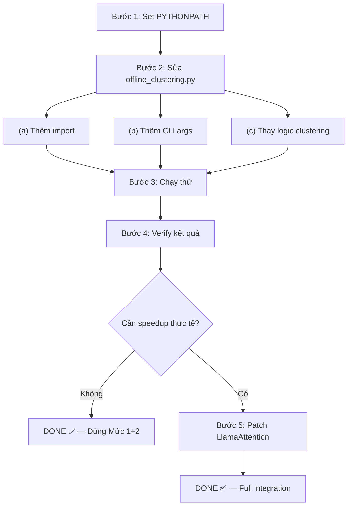

# 🚀 Hướng Dẫn Chi Tiết: Tích Hợp Value-Aware Retrieval vào SqueezedAttention

## Tổng Quan

Bạn có 2 thư mục nằm cạnh nhau:

```
SqueezedAttention-main/
├── SqueezedAttention-main/         ← repo gốc (có offline_clustering.py)
└── value_aware_squeezed_project/   ← project value-aware mới (extension)
```

Mục tiêu: tích hợp code value-aware vào repo gốc để cải thiện chất lượng clustering bằng cách tính thêm **value variance**.

> [!NOTE]
> Có 3 mức tích hợp. **Mức 1+2 là đủ cho đánh giá offline** (paper-style evaluation). Mức 3 chỉ cần khi muốn đo speedup thực tế trên GPU.

---

## 📋 Chuẩn Bị Trước Khi Bắt Đầu

### Kiểm tra cấu trúc thư mục

Mở terminal (PowerShell) và chạy:

```powershell
cd "C:\Users\DangDuc\Downloads\SqueezedAttention-main (2)\SqueezedAttention-main"
dir
```

Bạn phải thấy 2 thư mục:
- `SqueezedAttention-main/` — repo gốc
- `value_aware_squeezed_project/` — extension project

### Kiểm tra Python environment

```powershell
python --version
pip list | findstr torch
pip list | findstr transformers
```

> [!IMPORTANT]
> Đảm bảo bạn đã cài đủ dependencies của cả repo gốc lẫn value_aware project. Nếu chưa:
> ```powershell
> pip install -r value_aware_squeezed_project/requirements.txt
> ```

---

## ⭐ MỨC 1+2: Offline Integration (Khuyến nghị làm trước)

Đây là cách đơn giản nhất — chỉ sửa file `offline_clustering.py` của repo gốc.

---

### BƯỚC 1: Thiết lập PYTHONPATH

**Mục đích:** Để Python tìm thấy module `value_aware` từ project mới.

#### Trên PowerShell (Windows):

```powershell
cd "C:\Users\DangDuc\Downloads\SqueezedAttention-main (2)\SqueezedAttention-main\SqueezedAttention-main"

$env:PYTHONPATH = "C:\Users\DangDuc\Downloads\SqueezedAttention-main (2)\SqueezedAttention-main\value_aware_squeezed_project;$env:PYTHONPATH"
```

#### Verify đã set đúng:

```powershell
python -c "from value_aware.clustering import run_value_aware_clustering; print('OK - import thành công!')"
```

Nếu thấy `OK - import thành công!` → bạn đã setup đúng.

> [!WARNING]
> Biến `$env:PYTHONPATH` chỉ tồn tại trong phiên PowerShell hiện tại. Nếu đóng terminal và mở lại, bạn phải set lại. Để set vĩnh viễn, bạn cần thêm vào System Environment Variables.

---

### BƯỚC 2: Sửa file `offline_clustering.py` (repo gốc)

File cần sửa: [offline_clustering.py](file:///c:/Users/DangDuc/Downloads/SqueezedAttention-main%20(2)/SqueezedAttention-main/SqueezedAttention-main/offline_clustering.py)

Có **3 chỗ cần sửa** — tôi sẽ chỉ rõ từng chỗ:

---

#### Sửa (a): Thêm import value-aware — Dòng 20-21

**Tìm đoạn này** (dòng 20-21):
```python
from squeezedattention.clustering import run_clustering, run_global_threshold
from squeezedattention.utils import build_chat, truncate_fn
```

**Thêm 2 dòng ngay bên dưới:**
```python
from squeezedattention.clustering import run_clustering, run_global_threshold
from squeezedattention.utils import build_chat, truncate_fn
# === Value-Aware Extension ===
from value_aware.clustering import run_value_aware_clustering, normalize_value_variance
from value_aware.threshold import run_value_aware_global_threshold
```

**Giải thích:**
- `run_value_aware_clustering` — thay thế `run_clustering`, tính thêm value variance cho mỗi cluster
- `normalize_value_variance` — chuẩn hóa variance về khoảng [0,1]
- `run_value_aware_global_threshold` — thay thế `run_global_threshold`, tính threshold có tính đến variance

---

#### Sửa (b): Thêm CLI arguments — Dòng 45-46

**Tìm đoạn này** (khoảng dòng 44-46):
```python
    parser.add_argument('--observation_window', type=int, default=100)
    parser.add_argument('--device', type=int, default=0)

    args = parser.parse_args()
```

**Thêm 4 dòng argument mới trước `args = parser.parse_args()`:**
```python
    parser.add_argument('--observation_window', type=int, default=100)
    parser.add_argument('--device', type=int, default=0)

    # === Value-Aware Arguments ===
    parser.add_argument('--value_aware', action='store_true',
                        help='Enable value-aware retrieval (sử dụng cả values để tính clustering)')
    parser.add_argument('--alpha', type=float, default=1.0,
                        help='Trọng số key trong joint K-V distance (default: 1.0)')
    parser.add_argument('--beta', type=float, default=0.5,
                        help='Trọng số value variance trong joint distance (default: 0.5)')
    parser.add_argument('--gamma', type=float, default=0.3,
                        help='Hệ số boost score theo variance khi threshold (default: 0.3)')

    args = parser.parse_args()
```

**Giải thích từng tham số:**

| Tham số | Ý nghĩa | Giá trị mặc định |
|---------|---------|-------------------|
| `--value_aware` | Bật/tắt chế độ value-aware (flag, không cần giá trị) | Tắt |
| `--alpha` | Trọng số cho khoảng cách key trong clustering. Càng cao = key quan trọng hơn | 1.0 |
| `--beta` | Trọng số cho value variance. Càng cao = value variance ảnh hưởng clustering nhiều hơn | 0.5 |
| `--gamma` | Hệ số boost khi tính threshold. Cluster có variance cao sẽ được ưu tiên giữ lại | 0.3 |

---

#### Sửa (c): Thay logic clustering trong vòng lặp — Dòng 262-284

Đây là thay đổi chính. **Tìm đoạn code `else` (non-hierarchical case)** — dòng 262-284:

```python
        else:
            # compute centroids
            centroids_tensor_dict, centroids_labels_dict = run_clustering(all_keys_layers,
                                                                          num_centroids,
                                                                          observation_window=args.observation_window,
                                                                          device=torch.device('cpu'))

            # run global threshold
            global_threshold_dict = run_global_threshold(
                all_keys_layers, all_queries_layers, centroids_tensor_dict, centroids_labels_dict, num_centroids,
                observation_window=args.observation_window, device=torch.device('cpu')
            )

            # save centroids tensor, labels, global threshold
            os.makedirs(args.output_path, exist_ok=True)
            for k,v in centroids_tensor_dict.items():
                centroids_tensor_dict[k] = centroids_tensor_dict[k].cpu()
            for k,v in centroids_labels_dict.items():
                centroids_labels_dict[k] = centroids_labels_dict[k].cpu()

            torch.save(centroids_tensor_dict, f'{args.output_path}/centroids_tensor_dict_{dataidx}_{num_centroids}.pt')
            torch.save(centroids_labels_dict, f'{args.output_path}/centroids_labels_dict_{dataidx}_{num_centroids}.pt')
            torch.save(global_threshold_dict, f'{args.output_path}/global_threshold_{dataidx}_{num_centroids}.pt')
```

**Thay bằng đoạn code sau:**

```python
        else:
            if args.value_aware:
                # ===== VALUE-AWARE CLUSTERING =====
                # Tính joint K-V clustering + value variance
                kc_dict, vc_dict, lbl_dict, vvar_dict, nvar_dict = run_value_aware_clustering(
                    all_keys_layers, all_values_layers,
                    num_clusters=num_centroids,
                    observation_window=args.observation_window,
                    alpha=args.alpha, beta=args.beta,
                    device=torch.device('cpu'),
                )
                # Gán lại biến để code save phía dưới hoạt động
                centroids_tensor_dict, centroids_labels_dict = kc_dict, lbl_dict

                # Save thêm variance + value centroids để dùng cho online inference
                torch.save(nvar_dict, f'{args.output_path}/normalized_variance_{dataidx}_{num_centroids}.pt')
                torch.save(vc_dict, f'{args.output_path}/value_centroids_{dataidx}_{num_centroids}.pt')

                # Threshold value-aware: tính threshold có boost theo variance
                global_threshold_dict = run_value_aware_global_threshold(
                    keys_layers=all_keys_layers,
                    queries_layers=all_queries_layers,
                    key_centroids_dict=kc_dict,
                    labels_dict=lbl_dict,
                    normalized_variance_dict=nvar_dict,
                    num_clusters=num_centroids,
                    observation_window=args.observation_window,
                    gamma=args.gamma,
                    device=torch.device('cpu'),
                )
            else:
                # ===== BASELINE GỐC (không thay đổi) =====
                centroids_tensor_dict, centroids_labels_dict = run_clustering(
                    all_keys_layers,
                    num_centroids,
                    observation_window=args.observation_window,
                    device=torch.device('cpu'),
                )
                global_threshold_dict = run_global_threshold(
                    all_keys_layers, all_queries_layers,
                    centroids_tensor_dict, centroids_labels_dict, num_centroids,
                    observation_window=args.observation_window, device=torch.device('cpu'),
                )

            # save centroids tensor, labels, global threshold
            os.makedirs(args.output_path, exist_ok=True)
            for k,v in centroids_tensor_dict.items():
                centroids_tensor_dict[k] = centroids_tensor_dict[k].cpu()
            for k,v in centroids_labels_dict.items():
                centroids_labels_dict[k] = centroids_labels_dict[k].cpu()

            torch.save(centroids_tensor_dict, f'{args.output_path}/centroids_tensor_dict_{dataidx}_{num_centroids}.pt')
            torch.save(centroids_labels_dict, f'{args.output_path}/centroids_labels_dict_{dataidx}_{num_centroids}.pt')
            torch.save(global_threshold_dict, f'{args.output_path}/global_threshold_{dataidx}_{num_centroids}.pt')
```

> [!IMPORTANT]
> **Logic của thay đổi này:**
> - Nếu `--value_aware` **được bật**: gọi `run_value_aware_clustering` thay vì `run_clustering`, tính thêm value variance, và dùng `run_value_aware_global_threshold` để tính threshold có tính đến variance
> - Nếu `--value_aware` **không được bật**: chạy code gốc y nguyên, không thay đổi gì
> - Code save output không cần thay đổi vì biến `centroids_tensor_dict` và `centroids_labels_dict` được gán lại

---

### BƯỚC 3: Chạy Thử

#### Cách 1: Chạy bằng file đã sửa

```powershell
cd "C:\Users\DangDuc\Downloads\SqueezedAttention-main (2)\SqueezedAttention-main\SqueezedAttention-main"

# Set PYTHONPATH
$env:PYTHONPATH = "C:\Users\DangDuc\Downloads\SqueezedAttention-main (2)\SqueezedAttention-main\value_aware_squeezed_project;$env:PYTHONPATH"

# Chạy baseline gốc (kiểm tra code cũ vẫn hoạt động)
python offline_clustering.py LLaMA-2-7B-32K --dataset 2wikimqa --output_path output/clusters_baseline/ --percent_clusters 5 --observation_window 100 --device 0

# Chạy value-aware version
python offline_clustering.py LLaMA-2-7B-32K --dataset 2wikimqa --output_path output/clusters_va/ --percent_clusters 5 --observation_window 100 --value_aware --alpha 1.0 --beta 0.5 --gamma 0.3 --device 0
```

#### Cách 2: Dùng script patched có sẵn (không cần sửa file gốc)

Nếu bạn **không muốn sửa file gốc**, có thể dùng script đã patched sẵn:

```powershell
cd "C:\Users\DangDuc\Downloads\SqueezedAttention-main (2)\SqueezedAttention-main\SqueezedAttention-main"

python ../value_aware_squeezed_project/patches/offline_clustering_value_aware.py LLaMA-2-7B-32K --dataset 2wikimqa --output_path output/clusters_va/ --alpha 1.0 --beta 0.5 --gamma 0.3
```

> [!NOTE]
> Script patched ở [offline_clustering_value_aware.py](file:///c:/Users/DangDuc/Downloads/SqueezedAttention-main%20(2)/SqueezedAttention-main/value_aware_squeezed_project/patches/offline_clustering_value_aware.py) đã bao gồm sẵn tất cả thay đổi nêu trên, không cần phải sửa gì thêm.

---

### BƯỚC 4: Verification — So sánh kết quả

Chạy 3 lệnh sau để xác nhận code hoạt động đúng:

```powershell
# 1. Baseline gốc
python offline_clustering.py LLaMA-2-7B-32K --dataset 2wikimqa --output_path output/verify_baseline/ --percent_clusters 5

# 2. Value-aware với β=0, γ=0 → kết quả phải TƯƠNG ĐƯƠNG baseline
python offline_clustering.py LLaMA-2-7B-32K --dataset 2wikimqa --output_path output/verify_va_zero/ --percent_clusters 5 --value_aware --alpha 1.0 --beta 0.0 --gamma 0.0

# 3. Value-aware full → kết quả phải KHÁC baseline
python offline_clustering.py LLaMA-2-7B-32K --dataset 2wikimqa --output_path output/verify_va_full/ --percent_clusters 5 --value_aware --alpha 1.0 --beta 0.5 --gamma 0.3
```

**Kết quả mong đợi:**
- Lệnh 1 và 2: Centroid gần giống nhau (chỉ khác nhỏ do random init của K-means)
- Lệnh 3: Centroid khác rõ rệt hơn so với lệnh 1

---

## ⭐⭐⭐ MỨC 3: Online Attention Layer Patch (Nâng cao)

> [!CAUTION]
> Mức 3 chỉ cần khi bạn muốn đo **speedup thực tế** trên GPU. Nếu chỉ cần đánh giá accuracy, **bỏ qua mức này** và dùng Mức 1+2.

### BƯỚC 5: Patch `LlamaAttention.forward` trong custom transformers

File cần sửa: [modeling_llama.py](file:///c:/Users/DangDuc/Downloads/SqueezedAttention-main%20(2)/SqueezedAttention-main/SqueezedAttention-main/transformers/src/transformers/models/llama/modeling_llama.py)

#### 5a: Thêm config attributes vào `LlamaConfig`

Tìm class `LlamaConfig` trong file, thêm vào `__init__`:

```python
# Thêm trong LlamaConfig.__init__()
self.use_value_aware = kwargs.get("use_value_aware", False)
self.value_aware_gamma = kwargs.get("value_aware_gamma", 0.3)
```

#### 5b: Sửa `LlamaAttention.__init__`

Thêm vào cuối `__init__`:

```python
# Trong LlamaAttention.__init__()
self.use_value_aware = getattr(config, "use_value_aware", False)
self.gamma = getattr(config, "value_aware_gamma", 0.3)
```

#### 5c: Sửa `LlamaAttention.forward` — Thay đổi phần cluster scoring

Tìm chỗ tính **cluster scores** (centroid lookup), thường có dạng:

```python
attn_scores_centroids = torch.matmul(q, centroids.transpose(-2, -1))
```

Thay bằng logic value-aware:

```python
# Tính attention score với centroids
attn_scores_centroids = torch.matmul(q, centroids.transpose(-2, -1))

# Stable softmax với cluster sizes
exp_logits = torch.exp(attn_scores_centroids - attn_scores_centroids.max(-1, keepdim=True).values)
weighted = num_keys_per_cluster.unsqueeze(-2) * exp_logits
S = exp_logits / weighted.sum(-1, keepdim=True)

if self.use_value_aware:
    # === Value-aware boost ===
    # normalized_variance được load từ file precompute ở Bước 2
    # nvar shape: (B, H, K) — B=batch, H=heads, K=num_clusters
    S_adjusted = S * (1.0 + self.gamma * normalized_variance.unsqueeze(-2))
else:
    S_adjusted = S

# Threshold filter — chỉ giữ cluster có score > threshold
cluster_mask = S_adjusted > self.threshold

# Map cluster mask → per-token mask
key_mask = torch.gather(cluster_mask, -1, labels)

# Sparse attention
attn_logits = torch.matmul(q, k.transpose(-2, -1))
attn_logits = attn_logits.masked_fill(~key_mask, float('-inf'))
# ... tiếp tục softmax + matmul với v ...
```

> [!WARNING]
> Bước 5 cần bạn **hiểu rõ cấu trúc attention layer** trong file `modeling_llama.py` của repo gốc. Code trên là pseudocode — bạn cần tìm đúng vị trí trong file thực tế để chèn vào. Nếu chỉ muốn đánh giá accuracy, hãy dùng reference implementation Python trong `value_aware/retrieval.py` thay vì sửa kernel Triton.

---

## 🔧 Troubleshooting

| Lỗi | Nguyên nhân | Cách sửa |
|-----|------------|----------|
| `ModuleNotFoundError: value_aware` | PYTHONPATH chưa trỏ đến project | Chạy lại lệnh set `$env:PYTHONPATH` ở Bước 1 |
| `ImportError: cuml` | Repo gốc dùng cuML cho K-means | Project value-aware dùng PyTorch K-means, không cần cuML |
| Output shape mismatch | Code gốc expect `(1, H, K, D)` | `run_value_aware_clustering` đã trả đúng format này |
| KV budget không đạt target | gamma thay đổi distribution | Calibrate lại threshold với gamma đúng (đã được xử lý tự động) |
| `FileNotFoundError: LongBench/config/...` | Chạy từ sai thư mục | Phải `cd` vào `SqueezedAttention-main/` (repo gốc) trước khi chạy |
| CUDA out of memory | GPU VRAM không đủ | Giảm `--percent_clusters` hoặc dùng `--device cpu` |

---

## 📊 Tóm Tắt Flow


