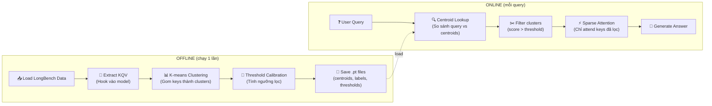
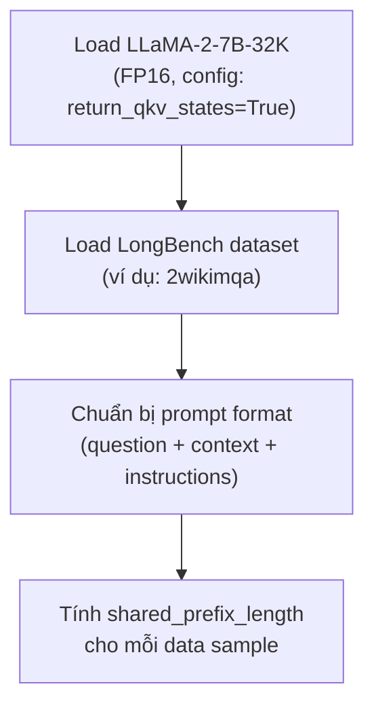
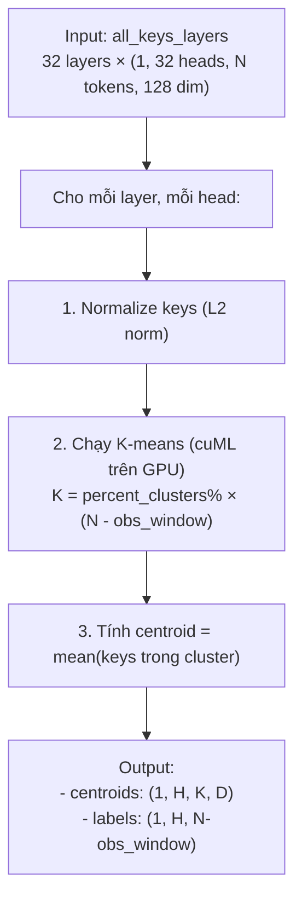
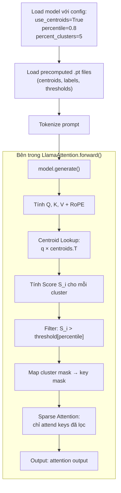
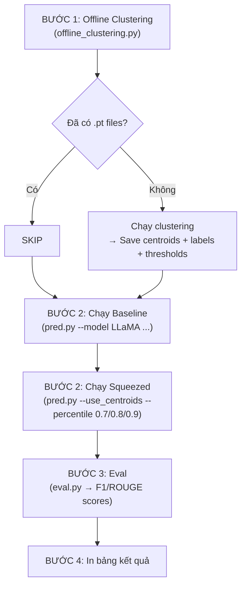
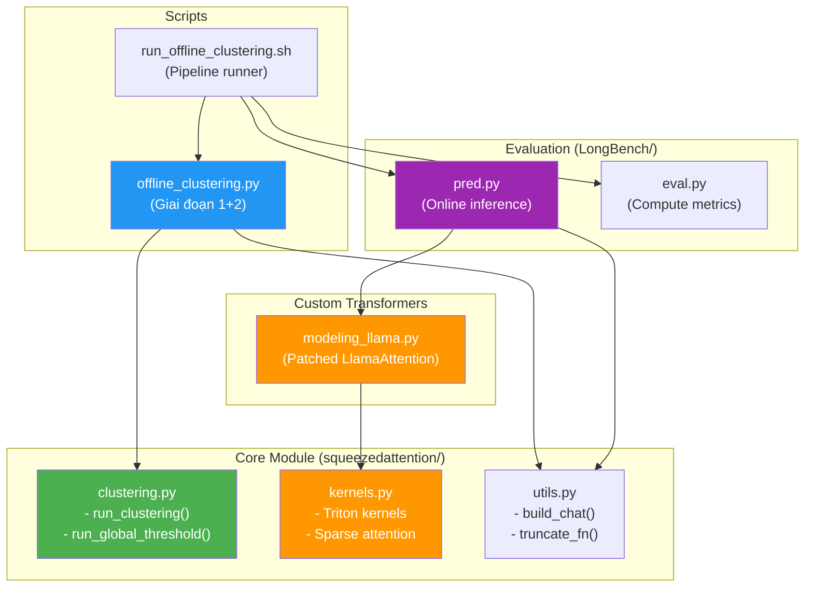

# 🧠 Giải Thích Chi Tiết Workflow Repo Gốc SqueezedAttention

## 1. Ý Tưởng Cốt Lõi — Bài Toán Gì?

### Bối cảnh

Khi dùng LLM (như LLaMA-2-7B-32K) để trả lời câu hỏi về một văn bản dài (ví dụ 10,000 tokens), **mỗi token mới sinh ra** phải tính attention với **toàn bộ** KV cache (10,000 keys + 10,000 values). Điều này:
- **Chậm**: O(n) cho mỗi token mới
- **Tốn VRAM**: phải giữ toàn bộ KV cache trong GPU memory

### Quan sát chính

> Trong nhiều ứng dụng, phần lớn prompt là **cố định** (ví dụ: nội dung tài liệu), chỉ phần **câu hỏi của user thay đổi**. Vậy ta có thể **tiền xử lý offline** phần cố định này!

### Ý tưởng SqueezedAttention

Thay vì tính attention với **tất cả 10,000 keys**, ta:
1. **Offline**: Gom keys thành **K nhóm (clusters)** bằng K-means → mỗi nhóm có 1 **centroid** (đại diện)
2. **Online**: Khi query đến, chỉ so sánh query với **K centroids** (ví dụ K=500) thay vì 10,000 keys
3. **Lọc**: Chỉ giữ lại clusters có score > threshold → lấy ra **subset keys** quan trọng
4. **Attention thật**: Tính attention chỉ với subset keys đã lọc

```
Ví dụ số:
- Prompt gốc: 10,000 tokens
- K-means gom thành: 500 clusters
- Query so sánh với 500 centroids → giữ lại 200 clusters
- 200 clusters chứa ~4,000 keys
- Attention chỉ tính với 4,000 keys thay vì 10,000
→ Tiết kiệm ~60% computation
```

---

## 2. Kiến Trúc Tổng Thể — 4 Giai Đoạn



---

## 3. Giai Đoạn 1: Offline Clustering (Chi Tiết)

### File chính: [offline_clustering.py](file:///c:/Users/DangDuc/Downloads/SqueezedAttention-main%20(2)/SqueezedAttention-main/SqueezedAttention-main/offline_clustering.py)

### Bước 3.1: Load Model + Data (Dòng 50–93)



**Giải thích `shared_prefix_length`:**

Giả sử prompt có dạng:
```
[Instructions] [Document content............] [Question: What is X?]
|<----------- shared prefix ------------>|  |<--- query part --->|
```

- **Shared prefix** = phần cố định (instructions + document) — KHÔNG thay đổi giữa các câu hỏi
- **Query part** = câu hỏi user — thay đổi mỗi lần

`shared_prefix_length` đếm số tokens trong shared prefix. Đây là vùng ta sẽ cluster.

### Bước 3.2: Extract KQV bằng Forward Hook (Dòng 107–140)

```python
def get_attention_scores(module, inp, out):
    _, qkv, _ = out
    queries, keys, values = qkv     # ← Model trả về Q, K, V cho mỗi layer
    sp_len = shared_prefix_length[dataidx]
    
    # Chỉ lấy phần shared prefix (bỏ query part)
    queries = queries[:,:,:sp_len].cpu()  # shape: (1, num_heads, sp_len, head_dim)
    keys = keys[:,:,:sp_len].cpu()        # shape: (1, num_heads, sp_len, head_dim)
    values = values[:,:,:sp_len].cpu()    # shape: (1, num_heads, sp_len, head_dim)
```

**Cách hoạt động:**
1. Hook được gắn vào **mỗi attention layer** (`layer.self_attn.register_forward_hook(...)`)
2. Chạy `model.generate(max_new_tokens=1)` — chỉ cần 1 token để kích hoạt tất cả hooks
3. Mỗi hook capture Q, K, V của layer đó → lưu vào list `all_queries_layers`, `all_keys_layers`, `all_values_layers`
4. Kết quả: có KQV cho **tất cả 32 layers** (LLaMA-2-7B có 32 layers)

> [!NOTE]
> `config.return_qkv_states = True` — đây là config đặc biệt trong bản transformers đã fork, cho phép trả về Q, K, V raw thay vì chỉ attention output.

### Bước 3.3: K-means Clustering (Dòng 264–267)

File: [clustering.py](file:///c:/Users/DangDuc/Downloads/SqueezedAttention-main%20(2)/SqueezedAttention-main/SqueezedAttention-main/squeezedattention/clustering.py)



**Giải thích `observation_window`:**

```
|<---- keys được cluster (N - 100) ---->|<-- observation_window (100) -->|
token_0  token_1  ...  token_{N-101}     token_{N-100}  ...  token_{N-1}
         ↓ K-means clustering                    ↓ dùng làm "test queries"
```

- **Keys bên trái** (N-100 tokens): được gom thành K clusters
- **Keys bên phải** (100 tokens cuối): giữ nguyên, dùng làm **observation window** — queries "mẫu" để calibrate threshold

**Tại sao?** Vì trong thực tế, khi user hỏi câu hỏi, query sẽ attend vào cả phần cuối document (gần query). 100 tokens cuối này mô phỏng vai trò "query đại diện" để tìm ngưỡng tốt.

### Chi tiết code K-means:

```python
# clustering.py, line 44-81
for H in range(num_heads):  # Cho mỗi head (32 heads)
    head_data_gpu = keys[H].to(calc_device)       # Đưa lên GPU
    data_normalized = F.normalize(head_data_gpu)    # L2 normalize
    
    # Chuyển sang CuPy format → chạy cuML K-means
    kmeans = KMeans(n_clusters=K, max_iter=100, init='k-means++')
    kmeans.fit(data_cp)
    cluster_labels = kmeans.labels_  # Mỗi key thuộc cluster nào
    
    # Tính centroid = trung bình keys trong mỗi cluster
    for i in range(K):
        mask = labels == i
        centroid = torch.mean(keys[mask], dim=0)  # shape: (128,)
```

**Output:**
- `centroids_tensor_dict[layer]` — shape `(1, num_heads, K, head_dim)` = `(1, 32, K, 128)`
  → Mỗi centroid là 1 vector 128 chiều đại diện cho 1 nhóm keys
- `centroids_labels_dict[layer]` — shape `(1, num_heads, N-obs_window)`
  → Gán nhãn: token thứ i thuộc cluster nào (0 đến K-1)

---

## 4. Giai Đoạn 2: Threshold Calibration (Chi Tiết)

### File: [clustering.py → run_global_threshold()](file:///c:/Users/DangDuc/Downloads/SqueezedAttention-main%20(2)/SqueezedAttention-main/SqueezedAttention-main/squeezedattention/clustering.py#L96-L165)

**Mục đích:** Tìm ngưỡng (threshold) để quyết định "cluster nào đủ quan trọng để giữ lại?"

### Công thức scoring

Cho query `q` và K centroids `C_1, C_2, ..., C_K`:

```
Score(q, cluster_i) = exp(q · C_i) / Σ_j (N_j · exp(q · C_j))
```

Trong đó:
- `q · C_i` = dot product giữa query và centroid i (tương tự attention score)
- `N_j` = số keys trong cluster j (cluster lớn hơn "cạnh tranh" nhiều hơn)
- **Tử số**: "cluster i quan trọng bao nhiêu?"
- **Mẫu số**: tổng weighted bởi số keys mỗi cluster → chuẩn hóa

> [!IMPORTANT]
> Đây chính là **ước lượng** attention weight mà cluster i sẽ nhận nếu tính full attention. Nếu Score cao → cluster này chứa keys mà query quan tâm.

### Code walkthrough:

```python
# Dòng 119: Tính attention scores giữa queries (observation window) và centroids
attn_scores_centroids = torch.matmul(queries_obs_window, centroids.T) / sqrt(d)
# shape: (H, obs_window, K)

# Dòng 124-127: Tính "estimated attention score" cho mỗi key
for k in range(K):
    label_mask = centroids_labels == k          # key nào thuộc cluster k?
    scores += label_mask * attn_scores_centroids[:,:,k]  # gán score cluster cho từng key

# Dòng 129-137: Tính mẫu số (denominator) với cluster sizes
num_keys_per_cluster = count(labels == k)        # N_j cho mỗi cluster
denom = sum(N_j * exp(q · C_j))                 # chuẩn hóa

# Dòng 139-140: Tính final score
scores_scaled = exp(scores) / denom              # ≈ estimated attention weight
score_avg = mean(scores_scaled, over_queries)     # trung bình qua obs_window queries
```

### Tính threshold bằng quantile:

```python
# Dòng 151-161
qlist = [0.5, 0.7, 0.8, 0.9]
thresholds = np.quantile(all_scores, qlist)
# Ví dụ kết quả:
# tdict = {0.5: 0.00023, 0.7: 0.00089, 0.8: 0.00201, 0.9: 0.00567}
```

**Ý nghĩa:** 
- `percentile=0.9` → giữ lại 10% clusters có score cao nhất → **nén mạnh, tốc độ nhanh, accuracy giảm**
- `percentile=0.5` → giữ lại 50% clusters → **nén ít, tốc độ chậm hơn, accuracy cao hơn**

### Output được save ra 3 file `.pt`:

```
output/
├── centroids_tensor_dict_0_500.pt   ← centroids (đại diện mỗi cluster)
├── centroids_labels_dict_0_500.pt   ← labels (key thuộc cluster nào)  
└── global_threshold_0_500.pt        ← threshold dict {0.5: x, 0.7: y, ...}
```

---

## 5. Giai Đoạn 3: Online Inference (Chi Tiết)

### File chính: [pred.py](file:///c:/Users/DangDuc/Downloads/SqueezedAttention-main%20(2)/SqueezedAttention-main/SqueezedAttention-main/LongBench/pred.py) + custom [modeling_llama.py](file:///c:/Users/DangDuc/Downloads/SqueezedAttention-main%20(2)/SqueezedAttention-main/SqueezedAttention-main/transformers/src/transformers/models/llama/modeling_llama.py)

### Flow khi `--use_centroids` được bật:



### Code trong LlamaAttention (custom transformers):

Repo gốc fork HuggingFace transformers và sửa `LlamaAttention.forward()` để:

1. **Load cluster data** từ file `.pt` (centroids, labels, threshold)
2. **Centroid lookup**: thay vì `q @ K.T` (10,000 ops), tính `q @ centroids.T` (500 ops)
3. **Filter**: chỉ giữ clusters có score > threshold
4. **Sparse attention**: dùng Triton kernel tính attention chỉ với keys đã lọc

### Triton Kernels: [kernels.py](file:///c:/Users/DangDuc/Downloads/SqueezedAttention-main%20(2)/SqueezedAttention-main/SqueezedAttention-main/squeezedattention/kernels.py)

File này chứa 4 Triton kernels tối ưu cho GPU:

| Kernel | Mục đích |
|--------|---------|
| `compact_indices_kernel` | Từ mask (1/0), tạo danh sách indices của keys được giữ lại |
| `_fwd_centroid_simple_kernel_qk` | Tính centroid scores `q @ centroids.T` + softmax + thresholding |
| `_fwd_kernel_qk` | Sparse attention: tính `q @ K_filtered.T` rồi `softmax @ V_filtered` |
| `_reduce_kernel_qk` | Gộp kết quả từ nhiều KV blocks (khi keys quá nhiều cho 1 block) |
| `_fwd_kernel_causal` | Standard causal attention cho observation window (không sparse) |

**Flow trong kernel:**

```
                    ┌──────────────────────┐
                    │ _fwd_centroid_simple  │  ← Bước 1: Centroid lookup
                    │  q × centroids.T     │
                    │  → cluster scores    │
                    │  → filter by thresh  │
                    └──────────┬───────────┘
                               │
                    ┌──────────▼───────────┐
                    │ compact_indices      │  ← Bước 2: Tạo index list
                    │  mask → [idx1, idx2] │     (chỉ indices keys được giữ)
                    └──────────┬───────────┘
                               │
                    ┌──────────▼───────────┐
                    │ _fwd_kernel_qk       │  ← Bước 3: Sparse attention
                    │  q × K[indices].T    │     (chỉ tính với keys đã lọc)
                    │  softmax             │
                    │  × V[indices]        │
                    └──────────┬───────────┘
                               │
                    ┌──────────▼───────────┐
                    │ _reduce_kernel_qk    │  ← Bước 4: Merge kết quả
                    │  (cross-block reduce)│
                    └──────────┬───────────┘
                               │
                    ┌──────────▼───────────┐
                    │ _fwd_kernel_causal   │  ← Bước 5: Causal attention
                    │  (cho obs_window)    │     cho 100 tokens cuối
                    └──────────────────────┘
```

---

## 6. Giai Đoạn 4: Evaluation

### File: [eval.py](file:///c:/Users/DangDuc/Downloads/SqueezedAttention-main%20(2)/SqueezedAttention-main/SqueezedAttention-main/LongBench/eval.py)

So sánh output model với ground truth bằng các metrics:
- **F1 Score** (cho QA tasks)
- **ROUGE** (cho summarization tasks)
- Accuracy (cho classification tasks)

---

## 7. Pipeline Script Tổng Hợp

### File: [run_offline_clustering.sh](file:///c:/Users/DangDuc/Downloads/SqueezedAttention-main%20(2)/SqueezedAttention-main/SqueezedAttention-main/run_offline_clustering.sh)

Script này gộp tất cả thành pipeline tự động:



### Ví dụ chạy cụ thể:

```bash
# Bước 1: Offline clustering
python offline_clustering.py LLaMA-2-7B-32K \
    --dataset qasper \
    --percent_clusters 5 \        # K = 5% × context_length
    --observation_window 100 \    # 100 tokens cuối dùng cho calibration
    --output_path Clusters-GPU/qasper/

# Bước 2: Baseline (full attention, không nén)
python LongBench/pred.py --model LLaMA-2-7B-32K --task qasper

# Bước 3: Squeezed Attention (có nén)
python LongBench/pred.py --model LLaMA-2-7B-32K \
    --use_centroids \             # bật sparse attention
    --percentile 0.8 \            # giữ 20% clusters score cao nhất
    --percent_clusters 5 \
    --path_to_clusters Clusters-GPU/ \
    --obs_window 100 \
    --task qasper

# Bước 4: Đánh giá
python LongBench/eval.py --model LLaMA-2-7B-32K --use_centroids --percentile 0.8
```

---

## 8. Ví Dụ Minh Họa Bằng Số

Giả sử 1 document có **5,000 tokens**, model LLaMA-2-7B (32 heads, head_dim=128):

```
Cài đặt: percent_clusters=5, observation_window=100, percentile=0.8

1. shared_prefix_length = 5,000 tokens

2. Keys để cluster = 5,000 - 100 = 4,900 tokens
   → K = 5% × 4,900 = 245 clusters

3. K-means chạy trên mỗi head:
   Input:  (4,900 keys, 128-dim) → 32 heads × 32 layers = 1,024 lần chạy K-means
   Output: 245 centroids mỗi head, mỗi centroid (128-dim)

4. Threshold calibration:
   - Dùng 100 queries (observation window)
   - Tính score cho mỗi key → lấy quantile 0.8
   - tdict[0.8] = 0.002 (ví dụ)

5. Online inference:
   - Query mới đến
   - So sánh với 245 centroids (thay vì 4,900 keys) → nhanh 20×
   - Score > 0.002 → giữ lại ~49 clusters (20% of 245)
   - 49 clusters chứa ~1,000 keys
   - Attention tính với 1,000 + 100 (obs window) = 1,100 keys
   
   → KV Budget = 1,100 / 5,000 = 22% (tiết kiệm 78% computation!)
```

---

## 9. Mối Quan Hệ Giữa Các File



---

## 10. Tóm Tắt: Đọc Code Theo Thứ Tự Nào?

Nếu bạn muốn hiểu sâu, đọc theo thứ tự:

| Thứ tự | File | Tại sao đọc |
|--------|------|-------------|
| 1️⃣ | [README.md](file:///c:/Users/DangDuc/Downloads/SqueezedAttention-main%20(2)/SqueezedAttention-main/SqueezedAttention-main/README.md) | Tổng quan ý tưởng |
| 2️⃣ | [utils.py](file:///c:/Users/DangDuc/Downloads/SqueezedAttention-main%20(2)/SqueezedAttention-main/SqueezedAttention-main/squeezedattention/utils.py) | Hiểu cách truncate prompt, tính shared_prefix_length |
| 3️⃣ | [offline_clustering.py](file:///c:/Users/DangDuc/Downloads/SqueezedAttention-main%20(2)/SqueezedAttention-main/SqueezedAttention-main/offline_clustering.py) | Flow chính offline — extract KQV + gọi clustering |
| 4️⃣ | [clustering.py](file:///c:/Users/DangDuc/Downloads/SqueezedAttention-main%20(2)/SqueezedAttention-main/SqueezedAttention-main/squeezedattention/clustering.py) | Core algorithm: K-means + threshold |
| 5️⃣ | [pred.py](file:///c:/Users/DangDuc/Downloads/SqueezedAttention-main%20(2)/SqueezedAttention-main/SqueezedAttention-main/LongBench/pred.py) | Flow online — load clusters + generate |
| 6️⃣ | [kernels.py](file:///c:/Users/DangDuc/Downloads/SqueezedAttention-main%20(2)/SqueezedAttention-main/SqueezedAttention-main/squeezedattention/kernels.py) | Triton kernels (advanced, đọc sau cùng) |
| 7️⃣ | [run_offline_clustering.sh](file:///c:/Users/DangDuc/Downloads/SqueezedAttention-main%20(2)/SqueezedAttention-main/SqueezedAttention-main/run_offline_clustering.sh) | Xem pipeline end-to-end |
